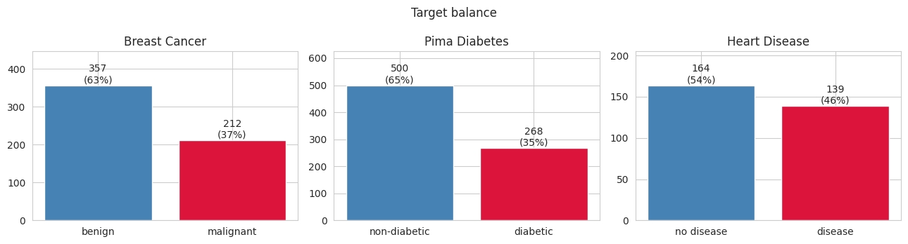
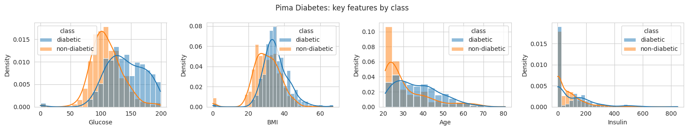
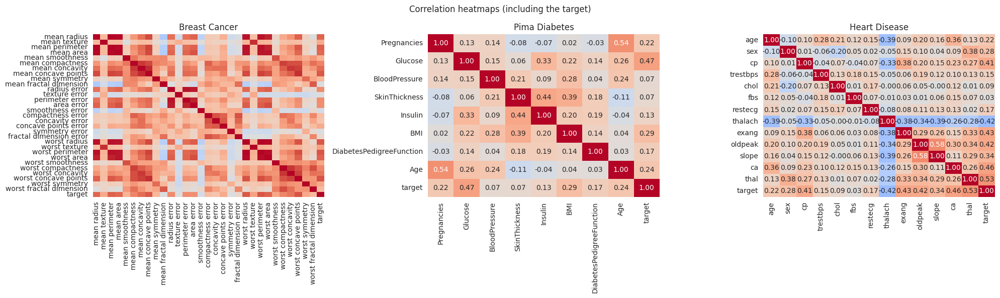
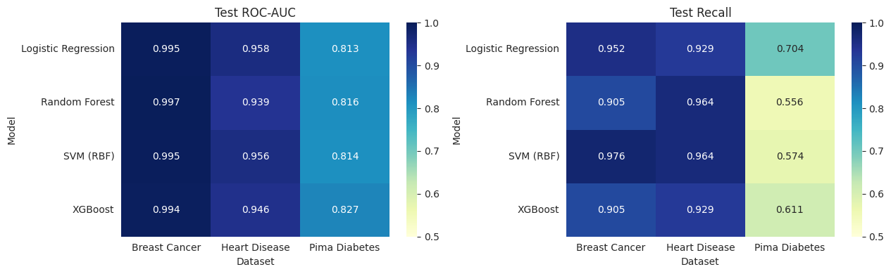
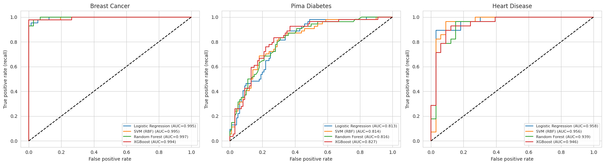
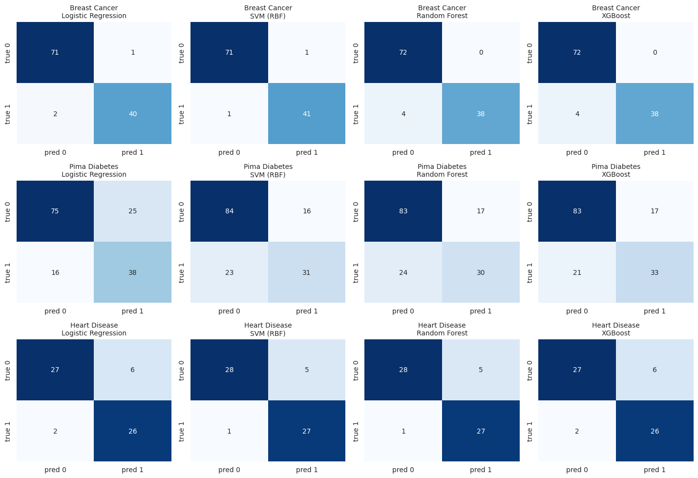
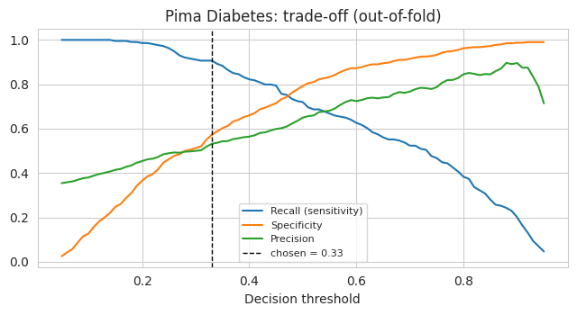
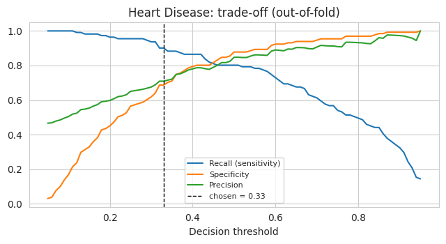
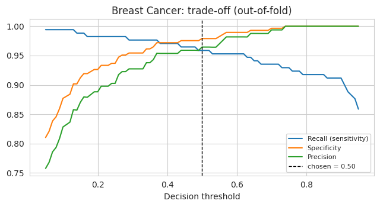
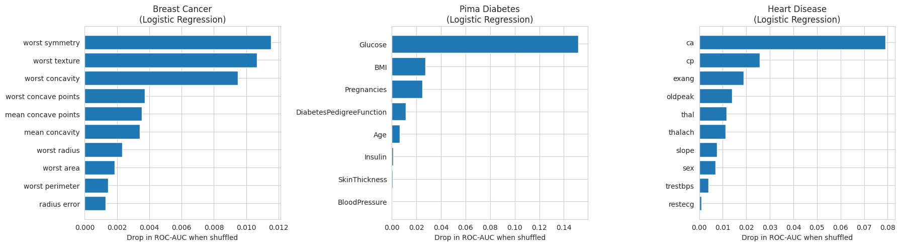

# Disease Prediction from Medical Data

**CodeAlpha Machine Learning Internship — Task 4**

[](https://colab.research.google.com/github/Nandishsk-07/CodeAlpha_DiseasePrediction/blob/main/CodeAlpha_DiseasePrediction.ipynb)

A machine learning project that predicts the **possibility of disease from patient data** on three classic medical datasets, using one shared, leakage-safe pipeline: **Breast Cancer** (malignant vs benign), **Pima Diabetes** and **Heart Disease**. Four classifiers are compared with cross-validation, tuned, and analysed with a screening-oriented decision threshold and permutation importance.

| Dataset | Best model (CV ROC-AUC) | Test ROC-AUC | Test accuracy | Test recall |
|---|---|---|---|---|
| Breast Cancer | Logistic Regression | **0.995** | 97.4% | 95.2% |
| Heart Disease | Logistic Regression | **0.961** | 86.9% | 92.9% |
| Pima Diabetes | Logistic Regression | **0.810** | 70.8% | 66.7% |

*(Tuned model, hold-out test set, default threshold 0.5. "Recall" = share of sick patients correctly caught.)*

> **Responsible-use note:** this is an educational project built on small, older public datasets. It is **not a diagnostic tool** and must not be used for medical decisions.

---

## Table of Contents
- [Overview](#overview)
- [Datasets](#datasets)
- [Workflow](#workflow)
- [Models and Evaluation](#models-and-evaluation)
- [Results](#results)
- [Threshold Analysis](#threshold-analysis-screening-vs-precision)
- [Explainability](#explainability)
- [Key Insights](#key-insights)
- [Limitations and Future Work](#limitations-and-future-work)
- [How to Run](#how-to-run)
- [Tech Stack](#tech-stack)
- [Project Structure](#project-structure)
- [Author](#author)

---

## Overview

In medicine, **missing a sick patient (a false negative) is worse than a false alarm**. This project is therefore built around more than plain accuracy:

- **Recall (sensitivity)**, specificity, precision, F1 and **ROC-AUC** are reported side by side
- The datasets are small, so models are compared with **stratified 5-fold cross-validation** (mean ± standard deviation) plus a held-out test set
- All preprocessing sits inside a scikit-learn **Pipeline**, so imputation and scaling are fitted on training folds only (**no data leakage**)
- Hidden data problems are checked and handled: impossible zeros (Pima), missing values (heart), duplicates
- A **decision threshold** is chosen on out-of-fold training predictions to reach a target recall, then applied once to the test set
- Models are explained with **permutation importance**

## Datasets

| Dataset | Rows | Features | Disease cases | Source |
|---|---|---|---|---|
| Breast Cancer Wisconsin (Diagnostic) | 569 | 30 (cell-nucleus measurements) | 37.3% malignant | built into scikit-learn |
| Pima Indians Diabetes | 768 | 8 (glucose, BMI, insulin, age, ...) | 34.9% diabetic | public CSV (or Kaggle `diabetes.csv`) |
| Heart Disease (Cleveland) | 303 | 13 (age, chest pain type, max heart rate, ...) | 45.9% with disease | UCI repository (or Kaggle `heart.csv`) |

In every dataset the target is encoded as **1 = disease present, 0 = no disease**.



**Data issues found and handled**

| Issue | Details | Handling |
|---|---|---|
| Impossible zeros in Pima | Insulin 374 rows (49%), SkinThickness 227 (30%), BloodPressure 35, BMI 11, Glucose 5 | Treated as missing, imputed inside the pipeline |
| Missing values in Heart | 6 values (`ca`: 4, `thal`: 2) | Imputed inside the pipeline |
| Duplicates | None found in these versions | Duplicate removal is built in. Some Kaggle copies of the heart data contain many duplicates, which would inflate scores. |





## Workflow

1. **Load** the three datasets and standardise the target
2. **EDA:** target balance, key features by class, correlation heatmaps
3. **Clean:** impossible zeros → missing, duplicate check
4. **Split:** stratified 80/20 train/test (Breast Cancer 455/114, Pima 614/154, Heart 242/61)
5. **Preprocess in a Pipeline:** numeric → median imputation + standard scaling; categorical (heart: `cp`, `restecg`, `slope`, `thal`) → most-frequent imputation + one-hot encoding
6. **Compare four models** with 5-fold stratified cross-validation, then evaluate on the test set
7. **Tune** the best model per dataset with `GridSearchCV` (scored on ROC-AUC)
8. **Choose a decision threshold** from out-of-fold predictions to reach 90% recall (never above 0.5)
9. **Explain** the model with permutation importance
10. **Predict** for new patients with a helper function, and save the models

## Models and Evaluation

**Models:** Logistic Regression, SVM (RBF kernel), Random Forest, XGBoost. Logistic Regression, SVM and Random Forest use `class_weight="balanced"` to give the rarer disease class more weight.

**Metrics:** accuracy, precision, recall (sensitivity), specificity, F1, ROC-AUC, confusion matrices and ROC curves.

## Results

### Cross-validation (5-fold, training data only, mean ± std)

| Dataset | Model | Accuracy | Recall | ROC-AUC |
|---|---|---|---|---|
| Breast Cancer | **Logistic Regression** | 0.971 ± 0.018 | 0.959 ± 0.030 | **0.995 ± 0.005** |
| | SVM (RBF) | 0.969 ± 0.011 | 0.953 ± 0.035 | 0.995 ± 0.004 |
| | Random Forest | 0.963 ± 0.013 | 0.941 ± 0.032 | 0.989 ± 0.007 |
| | XGBoost | 0.971 ± 0.011 | 0.953 ± 0.024 | 0.994 ± 0.004 |
| Pima Diabetes | **Logistic Regression** | 0.762 ± 0.011 | 0.701 ± 0.039 | **0.844 ± 0.016** |
| | SVM (RBF) | 0.761 ± 0.034 | 0.762 ± 0.052 | 0.837 ± 0.031 |
| | Random Forest | 0.772 ± 0.028 | 0.593 ± 0.025 | 0.823 ± 0.028 |
| | XGBoost | 0.751 ± 0.019 | 0.598 ± 0.052 | 0.811 ± 0.019 |
| Heart Disease | **Logistic Regression** | 0.847 ± 0.022 | 0.819 ± 0.051 | **0.907 ± 0.018** |
| | SVM (RBF) | 0.797 ± 0.028 | 0.783 ± 0.055 | 0.889 ± 0.024 |
| | Random Forest | 0.818 ± 0.025 | 0.765 ± 0.085 | 0.891 ± 0.031 |
| | XGBoost | 0.781 ± 0.021 | 0.756 ± 0.081 | 0.858 ± 0.024 |

### Hold-out test set (default threshold 0.5, models before tuning)

| Dataset | Model | Accuracy | Precision | Recall | Specificity | F1 | ROC-AUC |
|---|---|---|---|---|---|---|---|
| Breast Cancer | Logistic Regression | 0.974 | 0.976 | 0.952 | 0.986 | 0.964 | 0.995 |
| | SVM (RBF) | 0.982 | 0.976 | 0.976 | 0.986 | 0.976 | 0.995 |
| | Random Forest | 0.965 | 1.000 | 0.905 | 1.000 | 0.950 | 0.997 |
| | XGBoost | 0.965 | 1.000 | 0.905 | 1.000 | 0.950 | 0.994 |
| Pima Diabetes | Logistic Regression | 0.734 | 0.603 | 0.704 | 0.750 | 0.650 | 0.813 |
| | SVM (RBF) | 0.747 | 0.660 | 0.574 | 0.840 | 0.614 | 0.814 |
| | Random Forest | 0.734 | 0.638 | 0.556 | 0.830 | 0.594 | 0.816 |
| | XGBoost | 0.753 | 0.660 | 0.611 | 0.830 | 0.635 | 0.827 |
| Heart Disease | Logistic Regression | 0.869 | 0.812 | 0.929 | 0.818 | 0.867 | 0.958 |
| | SVM (RBF) | 0.902 | 0.844 | 0.964 | 0.848 | 0.900 | 0.956 |
| | Random Forest | 0.902 | 0.844 | 0.964 | 0.848 | 0.900 | 0.939 |
| | XGBoost | 0.869 | 0.812 | 0.929 | 0.818 | 0.867 | 0.946 |







### Hyperparameter tuning

For each dataset the model with the best cross-validated ROC-AUC (Logistic Regression in all three cases) was tuned with `GridSearchCV`.

| Dataset | Best parameters | CV ROC-AUC before → after | Test ROC-AUC before → after |
|---|---|---|---|
| Breast Cancer | C = 1 | 0.9954 → 0.9954 | 0.9954 → 0.9954 |
| Pima Diabetes | C = 0.1 | 0.8444 → 0.8450 | 0.8126 → 0.8104 |
| Heart Disease | C = 0.1 | 0.9069 → 0.9096 | 0.9578 → 0.9610 |

### Final tuned models on the test set (threshold 0.5)

| Dataset | Accuracy | Precision | Recall | Specificity | F1 | ROC-AUC |
|---|---|---|---|---|---|---|
| Breast Cancer | 0.974 | 0.976 | 0.952 | 0.986 | 0.964 | 0.995 |
| Pima Diabetes | 0.708 | 0.571 | 0.667 | 0.730 | 0.615 | 0.810 |
| Heart Disease | 0.869 | 0.812 | 0.929 | 0.818 | 0.867 | 0.961 |

## Threshold Analysis (screening vs precision)

By default a patient is flagged when the predicted probability is at least 0.5. For screening, a lower threshold catches more sick patients at the cost of more false alarms. The threshold was chosen on **out-of-fold predictions of the training data** (the highest threshold reaching 90% recall, never above 0.5) and then applied once to the test set, so the test set was not used to pick it.

| Dataset | Chosen threshold | Test recall (0.5 → chosen) | Test precision | Test specificity |
|---|---|---|---|---|
| Breast Cancer | 0.50 (default already reaches the target) | 0.952 | 0.976 | 0.986 |
| Pima Diabetes | 0.33 | 0.667 → **0.889** | 0.571 → 0.545 | 0.730 → 0.600 |
| Heart Disease | 0.33 | 0.929 → **1.000** | 0.812 → 0.718 | 0.818 → 0.667 |







## Explainability

**Permutation importance** shuffles one feature at a time on the test set and measures the drop in ROC-AUC.



- **Pima Diabetes:** **Glucose** dominates by a wide margin, followed by BMI and Pregnancies.
- **Heart Disease:** the number of major vessels (`ca`) comes first, then chest pain type (`cp`), exercise-induced angina (`exang`) and ST depression (`oldpeak`).
- **Breast Cancer:** importance is small and spread across several tumour-shape features (worst symmetry, worst texture, worst concavity), because many of the 30 features are strongly correlated with each other.

These rankings match general medical expectations for diabetes and heart disease, which is a useful sanity check.

## Key Insights

- **A simple model won everywhere:** Logistic Regression had the best cross-validated ROC-AUC on all three datasets (0.995, 0.844, 0.907). On small tabular datasets it is hard to beat. The gaps between the top models are often within one cross-validation standard deviation (for example on Breast Cancer), so they should not be over-interpreted.
- **Difficulty differs a lot by dataset:** Breast Cancer is nearly solved (test ROC-AUC 0.995), Heart Disease is good (0.961), and Pima Diabetes is the hardest (0.810, 70.8% accuracy), which is expected given its noisy features and the hidden missing values.
- **Tuning changed almost nothing:** CV and test ROC-AUC moved by at most 0.003, which suggests the default settings were already close to what these small datasets allow.
- **The threshold is a clinical choice:** on Pima, lowering it to 0.33 raised recall from 0.667 to 0.889 (catching 48 instead of 36 of the 54 diabetic patients in the test set) while specificity fell from 0.73 to 0.60. On Heart it reached 100% recall (all 28 patients with disease) while specificity fell to 0.667.
- **Test sets are tiny, so test numbers are noisy:** the heart test set has only 61 patients (28 with disease), so one patient changes recall by about 3.6 points. The heart test ROC-AUC (0.961) is also noticeably higher than the cross-validated value (0.910), so the cross-validation figures are the more trustworthy estimate.

## Limitations and Future Work

- Small, older datasets from specific populations; no external validation on a different hospital or population
- Test sets contain only 61–154 patients, so confidence intervals are wide
- Not calibrated or clinically validated; **not for clinical use**
- Future work:
  - SHAP explanations for individual predictions
  - Probability calibration and confidence intervals (for example bootstrapped)
  - External validation on a separate dataset
  - A Gradio or Streamlit risk-calculator app

## How to Run

**Option 1: Google Colab (recommended)**
1. Click the **Open in Colab** badge above
2. Choose **Runtime → Run all** (no GPU needed). The data downloads automatically: Breast Cancer comes from scikit-learn, Pima from a public CSV and Heart from the UCI repository.
3. Optional: to use your own Kaggle files, upload `heart.csv` and/or `diabetes.csv` to the Colab Files panel before running. The notebook uses them automatically if they are found.

**Option 2: Locally**
```bash
git clone https://github.com/Nandishsk-07/CodeAlpha_DiseasePrediction.git
cd CodeAlpha_DiseasePrediction
python -m venv venv
venv\Scripts\activate        # Mac/Linux: source venv/bin/activate
pip install -r requirements.txt
jupyter notebook
```
Open the notebook and run all cells.

## Tech Stack

- Python 3.10+
- Pandas, NumPy
- Scikit-learn
- XGBoost
- ucimlrepo (UCI dataset access)
- Matplotlib, Seaborn
- Joblib
- Jupyter / Google Colab

## Project Structure

```
CodeAlpha_DiseasePrediction/
├── CodeAlpha_DiseasePrediction.ipynb   # main notebook
├── README.md
├── requirements.txt
└── images/
    ├── target_balance.png
    ├── key_features_diabetes.png
    ├── correlation_heatmaps.png
    ├── metric_heatmaps.png
    ├── roc_curves.png
    ├── confusion_matrices.png
    ├── threshold_diabetes.png
    ├── threshold_heart.png
    ├── threshold_breast.png
    └── permutation_importance.png
```

## Author

**Nandish**
- GitHub: [@Nandishsk-07](https://github.com/Nandishsk-07)
- LinkedIn: <add your LinkedIn profile link>

## Acknowledgements

- Internship by [CodeAlpha](https://www.codealpha.tech)
- Datasets: Breast Cancer Wisconsin (Diagnostic), Pima Indians Diabetes (NIDDK) and Heart Disease (Cleveland), via the UCI Machine Learning Repository and public mirrors
